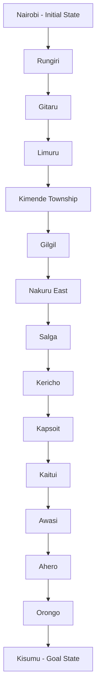

# Design of a Self-Driving Trailer Agent

## Question 1
Design the agent using the **PEAS framework** and define its environment using the **five definitions of agent environments**.

---

## 1. Agent Overview

The agent is an autonomous truck-and-trailer (articulated vehicle) that transports cargo from a loading depot to a destination without a human driver. Compared with a normal self-driving car, it has extra challenges:

- **Jackknifing** (trailer folding against the cab) and **trailer sway**
- **Wider turning radius** and **off-tracking** of the trailer
- **Longer braking distance** because of the heavy load
- **Large blind spots** behind and beside the trailer
- **Load shifting** and axle-weight limits

---

## 2. PEAS Framework

PEAS stands for **P**erformance measure, **E**nvironment, **A**ctuators, **S**ensors.

### 2.1 Performance Measure
How we judge whether the agent is doing well:

| Criterion | Description |
|---|---|
| Safety | Zero collisions, no jackknifing, no harm to pedestrians, cyclists or other drivers |
| Legal compliance | Obeys speed limits, traffic lights, lane rules, axle-load and weight limits |
| Timeliness | Cargo delivered on or before the scheduled time |
| Cargo integrity | Goods arrive undamaged and the load stays secure and balanced |
| Fuel efficiency | Minimum fuel consumption and cost per trip |
| Ride smoothness | Limited harsh braking, sharp turns and sudden acceleration |
| Reliability | Completes the trip without breakdown, with minimal need for human intervention |

### 2.2 Environment
Everything the agent operates in:

- **Roads:** highways, urban streets, junctions, roundabouts, bridges, roadworks, potholes, gradients and bends
- **Other road users:** cars, motorbikes (boda-bodas), matatus, buses, other trucks, pedestrians, cyclists, animals
- **Infrastructure:** traffic lights, road signs, lane markings, weigh bridges, toll points, loading bays and depots
- **Conditions:** rain, fog, darkness, glare, wet or slippery surfaces
- **Communication:** GPS satellites, mobile network, traffic information and a human operator or control centre

### 2.3 Actuators
How the agent acts on the environment:

- Steering control
- Accelerator (throttle)
- Brakes (service brakes, trailer air brakes, emergency brake)
- Gear selection
- Indicators, headlights, hazard lights, brake lights
- Horn
- Trailer coupling/hitch control and trailer brake controller
- Display, alarm or message system to alert the human operator or control centre

### 2.4 Sensors
How the agent perceives the environment:

| Sensor | What it perceives |
|---|---|
| Cameras | Lanes, signs, traffic lights, objects, pedestrians |
| LiDAR | 3D map of surroundings, distance to obstacles |
| Radar | Speed and distance of vehicles ahead and behind, works in fog and rain |
| Ultrasonic sensors | Close-range obstacles when reversing or docking |
| GPS / GNSS | Location and route progress |
| IMU (gyroscope and accelerometer) | Vehicle orientation, acceleration, sway |
| Speedometer / odometer | Speed and distance travelled |
| Hitch-angle sensor | Angle between cab and trailer (jackknife detection) |
| Load and weight sensors | Cargo weight and distribution |
| Tyre pressure and temperature sensors | Tyre condition |
| Fuel and engine sensors | Fuel level and engine health |
| Telematics / V2X link | Traffic, weather and route updates, communication with the control centre |

### 2.5 PEAS Summary Table

| Agent | Performance Measure | Environment | Actuators | Sensors |
|---|---|---|---|---|
| Self-driving trailer | Safety, legal compliance, on-time delivery, cargo integrity, fuel efficiency, smooth ride | Roads, traffic, pedestrians, weather, depots, weigh bridges | Steering, throttle, brakes, gears, lights, horn, hitch control, alerts | Cameras, LiDAR, radar, ultrasonic, GPS, IMU, hitch-angle, load, tyre, telematics |

---

## 3. Task Environment Properties (The 5 Definitions)

### 3.1 Fully Observable vs. Partially Observable
**Classification: PARTIALLY OBSERVABLE**

- A fully observable environment lets the agent's sensors see the complete state of the environment at every point in time.
- The trailer's sensors have limited range and field of view and can be affected by fog, rain, darkness or dirt.
- The agent cannot see around corners, through other vehicles or into blind spots behind the trailer.
- It cannot know the intentions of other drivers or pedestrians (for example, whether a car is about to cut in).
- Some internal states, such as the exact road friction or load shift, can only be estimated.
- **Implication:** the agent must keep an **internal state (model)** of the world and update it over time.

### 3.2 Deterministic vs. Stochastic
**Classification: STOCHASTIC**

- In a deterministic environment, the next state is completely determined by the current state and the agent's action.
- Here the same action can lead to different outcomes. Braking on a dry road stops the truck in a different distance than on a wet road.
- Other drivers, pedestrians and animals behave unpredictably.
- Tyre blowouts, sudden weather changes, potholes and mechanical faults occur randomly.
- **Implication:** the agent must reason with **probabilities and uncertainty** and keep safety margins.

### 3.3 Episodic vs. Sequential
**Classification: SEQUENTIAL**

- In an episodic environment, each decision is independent and the current choice does not affect future ones.
- Here every action affects later states. Speed, lane position and braking now determine following distance, trailer stability and the options available seconds later.
- A wrong early decision (for example, entering a bend too fast) can cause a crash later.
- The whole trip is a chain of connected decisions towards the goal.
- **Implication:** the agent must **plan ahead** and consider long-term consequences, not just the immediate percept.

### 3.4 Static vs. Dynamic
**Classification: DYNAMIC**

- A static environment does not change while the agent is deciding what to do.
- The road environment keeps changing: vehicles move, traffic lights change, pedestrians cross and weather shifts, whether or not the agent has finished deciding.
- Delay in decision-making can mean a collision.
- The environment can even change while the agent is acting (for example, a vehicle cuts in during an overtake).
- **Implication:** decisions must be made in **real time** and the agent must keep sensing and replanning continuously.

### 3.5 Single Agent vs. Multiagent
**Classification: MULTIAGENT**

- A single-agent environment has only one agent acting; a multiagent environment has other agents whose behaviour affects the agent's performance.
- The road contains many other agents: other drivers, motorcyclists, cyclists, pedestrians, other autonomous vehicles and traffic police.
- **Competitive aspects:** competing for road space, lane merging, overtaking, parking and loading-bay space.
- **Cooperative aspects:** avoiding collisions, giving way, signalling intentions and platooning with other trucks.
- **Implication:** the agent must **predict the behaviour of others** and communicate its own intentions (indicators, lights, V2X).

### 3.6 Environment Properties Summary Table

| Property | Classification | Main Reason |
|---|---|---|
| Observability | **Partially observable** | Limited sensor range, blind spots, weather, hidden intentions of others |
| Determinism | **Stochastic** | Unpredictable drivers, weather, road surface and mechanical events |
| Episodic / Sequential | **Sequential** | Each action affects future states and safety |
| Static / Dynamic | **Dynamic** | Traffic and conditions change while the agent decides |
| Agents | **Multiagent** | Many other drivers and pedestrians, both competitive and cooperative |

**Additional property (not one of the five):** **Continuous.** Speed, steering angle, hitch angle, position and time all take continuous values. Another common one is **Unknown/Known**: the agent knows the rules of physics and traffic, but not every road or situation in advance.

---

---

## Question 2: Directed Graph and Search Tree

### 2.1 Directed Graph of Kenya's Highway Network

A directed graph is used to represent the highway network connecting Nairobi to Kisumu. The graph is represented as \(G=(V,E)\), where \(V\) is the set of towns (vertices) and \(E\) is the set of road connections (edges). Each vertex represents a town, while each directed edge represents a road connection from one town to another.

The network represents towns along the selected route through the Central Highlands, Rift Valley and Lake Victoria Basin regions. The locations used are Nairobi, Rungiri, Gitaru, Limuru, Kimende Township, Gilgil, Nakuru East, Salga, Kericho, Kapsoit, Kaitui, Awasi, Ahero, Orongo and Kisumu.

The graph abstracts away individual road bends, roadside buildings and other unnecessary physical details, retaining the towns and road connections needed for route planning.

#### Directed Graph

The arrows indicate the direction of travel from Nairobi towards Kisumu. The graph is a simplified representation of the collected route data. The actual road connections and directionality between consecutive towns should be confirmed using Google Maps and the highway map presented in class.

### 2.2 Search Tree Using Abstraction

A search tree represents the possible paths explored by the searching agent from the initial state to the goal state. The initial state is Nairobi, and the goal state is Kisumu. Intermediate towns represent possible states encountered while travelling along the highway network.

Abstraction is applied by representing each town as a single state and each road connection as an edge. The model does not represent every bend, junction detail or roadside feature because these details are unnecessary for comparing town-to-town routes.

#### Search Tree

This tree illustrates one candidate path from Nairobi to Kisumu. In the complete highway network, the search tree can branch at junctions where alternative roads are available. The agent compares these alternatives using their accumulated path costs.

### 2.3 Nodes, Edges and Road Connections

The vertices are the towns along the route. The edges are the road connections between consecutive towns. Each edge is assigned a cost based on the road distance between its endpoints.

The collected cumulative distances from Nairobi are:

| Town | Cumulative distance from Nairobi (km) |
|---|---:|
| Nairobi | 0 |
| Rungiri | 19 |
| Gitaru | 23.1 |
| Limuru | 38.1 |
| Kimende Township | 52.6 |
| Gilgil | 121 |
| Nakuru East | 151 |
| Salga | 188 |
| Kericho | 266 |
| Kapsoit | 277 |
| Kaitui | 288 |
| Awasi | 308 |
| Ahero | 326 |
| Orongo | 341 |
| Kisumu | 352 |

These values are cumulative distances rather than individual road-segment distances. For consecutive towns on the same route, the segment cost can be calculated as:

\[
c(A,B)=D(B)-D(A)
\]

where \(D(A)\) and \(D(B)\) are the cumulative distances of towns \(A\) and \(B\) from Nairobi.

The cumulative distances and town order must be verified against the same Google Maps route before the differences are treated as actual edge costs.

